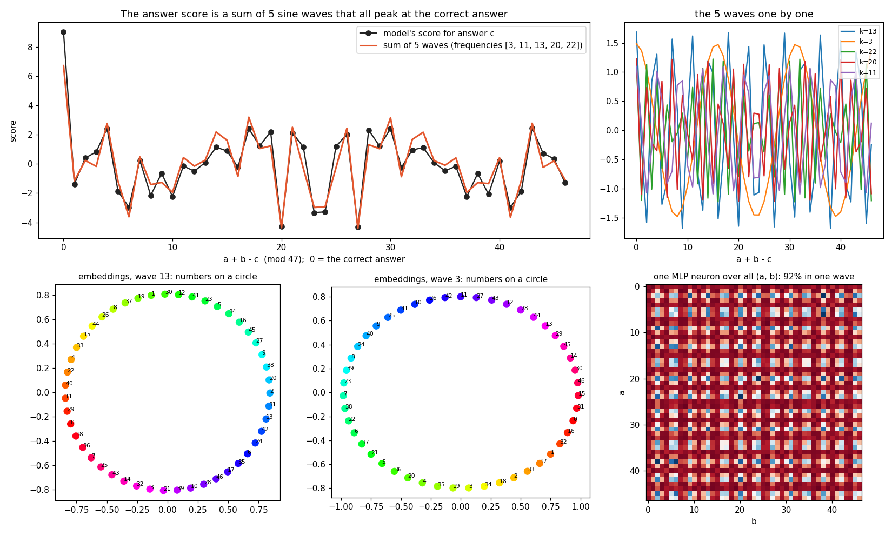
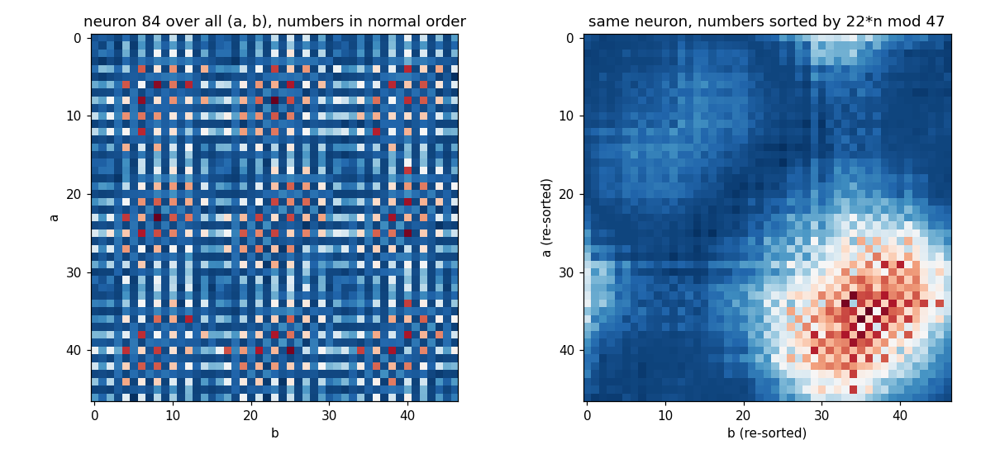

# Theory of LLMs

What do small language models actually build inside when they learn? We open up trained models and check every claim with an experiment.

| What we found | One example | Page |
|---|---|---|
| A model that adds numbers invents a clock | every number is a point on a circle; 5 clocks of different speeds add up to a spike at the right answer | [clock-addition](findings/clock-addition.md) |
| Each clock is run by 2-4 neurons out of 128 | removing 3 neurons: 99% -> 83%; removing 3 random ones: 98% | [neuron-teams](findings/neuron-teams.md) |
| A neuron that looks like noise is a smooth wave in the model's own number order | sort numbers by 22 x n mod 47 and the noise becomes one hill | [neuron-teams](findings/neuron-teams.md) |
| Weight decay is what makes it find the clock | without it the model memorizes and stays at 60% on new pairs | [weight-decay-forces-the-clock](findings/weight-decay-forces-the-clock.md) |
| To copy text, a model builds a two-head machine | one head marks the previous word, a second finds the earlier copy and reads the next word | [copy-heads](findings/copy-heads.md) |
| The copy machine appears late in training | not there at step 260, built by step 1,200 | [copy-heads](findings/copy-heads.md) |
| Experts split by skill on their own | facts and counting share one expert, copy and sort another | [experts-split-by-skill](findings/experts-split-by-skill.md) |
| Counts are stored in order on a bent line | 0, 1, 2, 3, 4 zeros sit in order; one straight readout gets 99% | [count-on-a-line](findings/count-on-a-line.md) |
| Counts are a line in the middle layer but separate corners in the last layer | adding one count direction sets the asked count 0-5% of the time at the last layer; adding mean(target count) - mean(current count) 100%; a one-number straightness check predicts which | [ordered-values-bend](findings/ordered-values-bend.md) |
| The learning rate sets how fast a model learns, not where it ends up | rates 0.001 to 0.16 all end within 0.01 of each other | [learning-rate-sets-speed](findings/learning-rate-sets-speed.md) |
| Three things change Muon's best learning rate: batch size, momentum and learning rate decay | batch 4 -> 32 raises it 3x; width, depth, warmup and data barely move it | [what-changes-muon-learning-rate](findings/what-changes-muon-learning-rate.md) |
| Without QK-norm, Muon's attention scores blow up above about 3x the best learning rate | largest score 12 at lr 0.028, 653 at 0.057; QK-Clip at threshold 100 doesn't stop the damage at 8x the best lr, a threshold near healthy scores does | [muon-attention-blowup](findings/muon-attention-blowup.md) |
| When Muon needs QK-Clip, and how to set it | not needed at the normal lr even in long runs; threshold 100 is enough up to 4x the best lr; check every 10 steps; keep it on while lr is high; weight decay 0.3 on only W_q, W_k does the same job | [muon-qkclip-rules](findings/muon-qkclip-rules.md) |
| Repeating data with Muon needs much higher weight decay, on embedding and head too | best weight decay 0.1 at 4 epochs, 3 at 16, 10 at 32; keeping 0.1 at 16 epochs costs 0.57 loss | [muon-weight-decay-epochs](findings/muon-weight-decay-epochs.md) |
| With Muon, orthogonalize each MoE expert alone | experts treated as one fused matrix: 66% facts right vs 82% per expert, close to a dense model (63%) | [muon-moe-expert-layout](findings/muon-moe-expert-layout.md) |
| Keep gradient clipping on for Muon matrices, with a low threshold | clipping only the Adam group under bad batches: loss 4.158; clipping everything at 1.0: 4.037; at half the usual gradient norm: 4.026 (clean 4.029) | [muon-grad-clipping](findings/muon-grad-clipping.md) |
| Muon packs features the same way, and its weight decay sets how many fit | 5 dimensions hold 5 always-on features but 19 of 20 rare ones; weight decay 1 cuts 16 stored features to 7, weight decay 2 to 3 | [muon-superposition](findings/muon-superposition.md) |
| A sparse autoencoder sees answers, not the clock | 46 of 64 latents each fire on one answer ("the answer is 29"), 0 are a clock; laid out in answer order, their decoder vectors show the 5 clock speeds | [sae-sees-answers-not-clocks](findings/sae-sees-answers-not-clocks.md) |
| A transcoder keeps the inputs and drops the sum | with 4 of 64 latents active it rebuilds 98% of each number alone but 71% of the sum; accuracy 99% -> 72%; the loss grows with width (9% -> 21% from width 32 to 128) and a skip connection cuts it to under 5% | [transcoders-drop-the-sum](findings/transcoders-drop-the-sum.md) |
| Fine-tuning on a few fixed tasks makes a model stop reading the prompt; 5% made-up-rule examples prevent it | after fine-tuning on 8 tasks, a new rule shown in the prompt is answered right 13% of the time (was 100%); with 5% made-up-rule sequences mixed in, 97%, and the 8 tasks stay at 99.8%; holds from 29k to 418k parameters and 1x to 16x fine-tuning | [fine-tuning-stops-prompt-reading](findings/fine-tuning-stops-prompt-reading.md) |

All findings in reading order: [SUMMARY.md](SUMMARY.md). Open questions: [OPEN.md](OPEN.md). Code behind each page: [experiments/](experiments/). All models are trained with the Muon optimizer.
