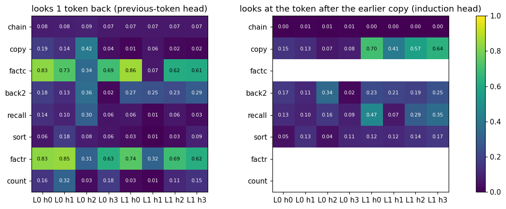

# The two-head copy machine

**Claim:** to copy text, a 2-layer model builds two cooperating heads: a layer-0 head looks 1 token back, and layer-1 heads look at the token after the earlier copy of the current token. Status: proven (seed 0).

**Example:** on the copy task, layer-1 heads 0, 2, 3 put 0.70, 0.57, 0.64 of their attention on that token. The recall task reuses layer-1 head 0 (0.47).

The machine does not exist at step 260 (0.29) and is built by step 1,200: you can watch it appear during training.

Code: [experiments/eight-skills](../experiments/eight-skills/).
