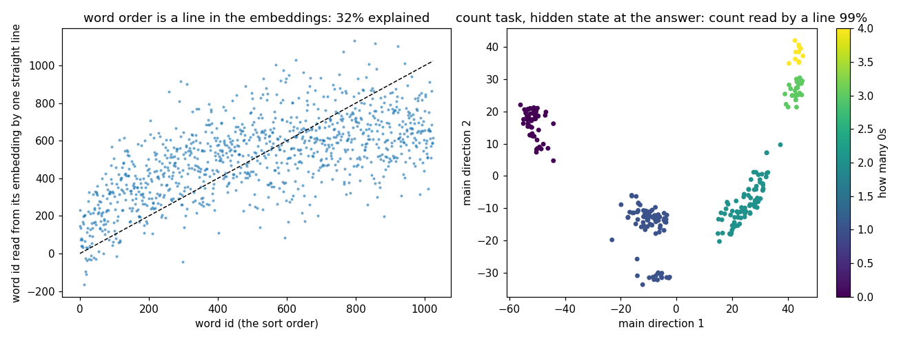

# Counts on a line

**Claim:** when counting zeros, the model stores the count as points in order along a bent line (0, 1, 2, 3, 4), and one straight readout recovers it 99% of the time. Status: proven (seed 0).

Word order (needed for sorting) is only 32% readable from the word embeddings, and sorting stays at 58% accuracy.
