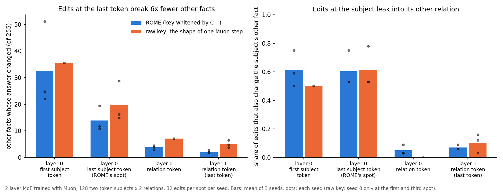

# Edit a fact at the last token, not at the subject: 6× fewer other facts break

ROME edits the MLP at the last subject token. I edited the same 32 facts at each MLP spot of a small model and counted how many of the other 255 facts changed their answer.

1. At ROME's spot (the last subject token), each edit changed 13.9 other facts on average. 60% of edits also rewrote the same subject's other fact. At the last token in the last layer, an edit changed 2.2 other facts and rewrote the subject's other fact 7% of the time. Every edit there worked, against 90% at ROME's spot.

| where the edit goes | edits that work | other facts changed (of 255) | the subject's other fact also changed |
|---|---|---|---|
| layer 0, first subject token | 94% | 32.7 | 61% |
| layer 0, last subject token (ROME's spot) | 90% | 13.9 | 60% |
| layer 0, relation token | 100% | 3.8 | 5% |
| layer 1, relation token (last token) | 100% | 2.2 | 7% |

Example: say the edit makes "Ana Bel, lives in →" give Rome instead of Oslo. At the subject spot it also changes "Ana Bel, works at →" in 6 of 10 edits, because the change fires on every prompt about Ana Bel. At the last token it fires only when both the subject and the relation match.

2. ROME's C⁻¹ whitening of the key is what keeps last-token edits clean. Dropping it (writing d kᵀ / |k|², the direction a single Muon step on that one fact would take) changes 5.0 other facts at the last token instead of 2.2 (2.3×). Loss on the other 6 skills rises 6× more (+0.0024 vs +0.0004). At the subject spot the whitening barely matters (19.9 vs 13.9), because the leak comes from where the edit sits, not from the key.

3. Where it stops: when the relation comes before the subject in the prompt, the subject token already knows the relation and the leak is gone. In the toy's default fact task, which uses one-token subjects, an edit at the subject changed the subject's other fact in 9% of edits (seed 0). At the last token in the last layer it changed 0.4 other facts (of 127).

4. Correcting the fact by plain fine-tuning with Muon on that one prompt changes 14-18 other facts when every matrix trains, at any step size from 0.002 to 0.02. It changes 3.3 when only the last-layer MLP trains (seed 0). Orthogonalizing the step is not the cause: the same steps without orthogonalization change 18-41.

## How to use this

If your prompts put the subject before the relation, as in "Paris is the capital of", "X was born in" and most English facts, edit at the last token in a late layer instead of at the last subject token. Keep the C⁻¹ key whitening there. To patch a fact by fine-tuning, train only the last-layer MLP, not the whole model.

## What is new and what is not

[Liu et al. 2025, "Relation Also Knows" (RETS)](https://arxiv.org/abs/2408.15091) found the same leak in GPT-2 and GPT-J. Their edit at the last relation token reduces it by over 30% on their relation-specificity metric. [2506.04042](https://arxiv.org/abs/2506.04042) also blames ROME's leaks on subject-only features. [ROME](https://arxiv.org/abs/2202.05262) reports that other token positions generalize worse in GPT-2 XL. New here:
- The count of other facts broken per spot, on an MoE trained with Muon.
- That the C⁻¹ whitening matters at the last token (2.3× fewer broken facts) but not at the subject. I found only unreviewed notes on this ablation.
- That the leak disappears when the relation comes first.
- How a one-prompt Muon fine-tune compares.
This is a 2-layer toy with 256 facts, so the counts will differ in large models.

## Data

Same model and edits as [mlp-edit-without-storage](mlp-edit-without-storage.md): 2-layer MoE trained with Muon at lr 0.028, 128 two-token subjects × 2 relations, 32 edits per spot per seed, seeds 0-2.

Per seed (0 / 1 / 2), at the four spots in table order:
- ROME other facts changed: 24.8 11.7 3.0 1.9 / 22.1 10.7 4.5 2.0 / 51.1 19.4 3.9 2.7
- ROME subject's other fact changed: 0.50 0.53 0.03 0.06 / 0.59 0.53 0.09 0.06 / 0.75 0.75 0.03 0.09
- Raw key, other facts changed: 35.5 14.8 7.1 6.5 / – 16.2 – 3.7 / – 28.7 – 4.8
- Raw key, subject's other fact changed: 0.50 0.53 0.00 0.16 / – 0.53 – 0.03 / – 0.78 – 0.12
- Other-skill loss at the last token, ROME vs raw: 0.0005 vs 0.0028 / 0.0005 vs 0.0011 / 0.0002 vs 0.0032

Muon fine-tune on the one prompt, seed 0, stopping when p(new) > 0.9 or after 100 steps, at each lr (edits that work / other facts changed):
- all matrices: lr 0.002 97% / 14.3; 0.005 100% / 16.7; 0.02 100% / 18.4
- last-layer MLP: 0.02 100% / 3.3
- all layers' MLPs: 0.005 97% / 9.3
- attention only: 0.005 100% / 23.0
- no orthogonalization (step scaled to the same size): 0.005 100% / 18.2; 0.02 100% / 41.2

Code: [facts.py](../experiments/fact-editing/facts.py) (`EDIT=rome|raw|ft edit SEED`), [figure.py](../experiments/fact-editing/figure.py), [results.json](../experiments/fact-editing/results.json), [NOTES.md](../experiments/fact-editing/NOTES.md).
