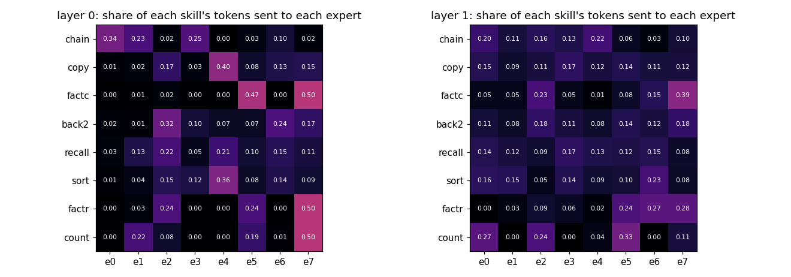

# Experts split by skill

**Claim:** in a mixture-of-experts model trained on 8 skills, the first layer's experts split by skill without being told; the second layer's do not. Status: proven (seed 0).

**Example:** both fact skills and counting send half their tokens to expert 7; copy and sort mostly use expert 4.

