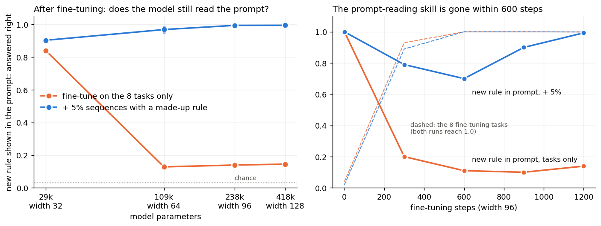

# Fine-tuning on a few fixed tasks makes a model stop reading the prompt; 5% of examples with a made-up rule prevent it

**Claim:** a model that already learns new rules from examples in its prompt loses that skill when it is fine-tuned on a small, fixed set of tasks, even though every fine-tuning example is itself a few-shot prompt. Bigger models lose it more. Mixing in 5% of sequences whose rule is made up fresh each time, so the answer exists only in the prompt, keeps the skill at no cost to the fine-tuned tasks.

**Example:** a width-64 model is first trained on prompts that each show 8 pairs of a brand-new random lookup table (`x1 y1 x2 y2 ...`). It learns to answer an input it has already seen in the prompt with the label the prompt gave it: 1.0. Then it is fine-tuned for 1,200 steps on 8 fixed tables, still shown as 8-pair prompts. Afterwards:

| fine-tuning mix | 8 fine-tuning tasks right | new rule shown in the prompt, answered right |
|---|---|---|
| the 8 tasks only | 0.999 | 0.13 (chance 0.03) |
| + 2% made-up-rule sequences | 0.999 | 0.72 |
| + 5% made-up-rule sequences | 0.998 | 0.97 |
| + 10% made-up-rule sequences | 0.996 | 1.00 |
| + 5% made-up rules where no input repeats (nothing to read) | 0.997 | 0.13 |

(mean of 3 seeds for "tasks only" and "5%": 0.13 → 0.97; other rows seed 0.) After fine-tuning on the tasks only, the model also ignores the prompt when it contradicts a stored task: relabel 3 inputs of a fine-tuning task in the prompt and it follows the prompt 0.11 of the time; with the 5% mix, 0.97 (3 seeds).

**Why:** once the 8 tables are stored in the weights, the stored answer is as good as reading the prompt, so nothing rewards the reading circuit and the fine-tuning updates overwrite it. The skill is gone within 600 steps. Sequences whose answer exists only in the prompt keep rewarding it; made-up rules with nothing to read (no input repeats) do not help, so it is the reward for reading that matters, not the extra variety.

**Held at:**

| width (parameters) | tasks only | + 5% | 8 tasks right (tasks only / + 5%) |
|---|---|---|---|
| 32 (29k) | 0.84 | 0.90 | 0.58 / 0.80 |
| 64 (109k) | 0.13 | 0.97 | 0.998 / 0.997 |
| 96 (238k) | 0.14 | 0.99 | 0.999 / 0.999 |
| 128 (418k) | 0.15 | 0.99 | 1.0 / 0.999 |

(3 seeds at width 64, 2 at 96 and 128, 1 at 32; width 32 was pretrained 1,500 steps instead of 600 so it starts at 1.0.)

- Size: the loss of the skill grows with size: -0.16 at width 32 (it memorizes the 8 tasks slowly, 0.58 right), -0.87 at width 64 and above. The 5% fix holds at every size from 29k to 418k parameters (14×).
- Length: at width 64, fine-tuning 300 / 1,200 / 4,800 steps (1× / 4× / 16×) leaves 0.71 / 0.13 / 0.14 without the mix and 0.99 / 0.97 / 1.00 with 5% (at 300 steps the 8 tasks are only half learned, 0.57 / 0.47; at 1,200 and 4,800 they are 0.997-1.0 either way).
- The same fade happens without a separate pretraining stage: trained from scratch on 32 fixed tables, the model first learns to read the prompt (0.99 at step 600) and then loses it as it memorizes the tables (0.44 at 4,800 steps, mean of 3 seeds at width 64; 0.35 at width 96). 2% made-up-rule sequences keep it at 0.97 (width 64, 3 seeds) and 0.98 (width 96), with the tables still 0.97 / 0.99 right.

**How to use this:** when fine-tuning (or training for many epochs) on a fixed set of tasks, keep about 5% of sequences whose labels are made up per example (random symbols mapped to inputs, with each input repeated in the prompt) so the only way to be right is to read the prompt. Check after fine-tuning with prompts whose labels contradict what the model knows (flipped or random labels): if it follows the stored answer, the reading skill is gone.

**What is new and what is not:** in-context learning fading after it appears is known in toys (Singh 2023, [2311.08360](https://arxiv.org/abs/2311.08360); Singh 2025, [2503.05631](https://arxiv.org/abs/2503.05631), who make it persist by making every context example match the query, with no mix fraction). Symbol tuning (Wei 2023, [2305.08298](https://arxiv.org/abs/2305.08298)) reports in Flan-PaLM 8B-540B that the ability to follow flipped labels is lost during instruction tuning and can be restored by a separate tuning stage on arbitrary-label prompts, with 16% or more of such data in their mixes. New here: the loss happens even when all fine-tuning data is in few-shot form, it grows with model size, 5% mixed into the fine-tuning itself prevents it with no cost to the fine-tuned tasks, and the mix only works if the prompt actually holds the answer.

Limits: 2-layer models up to 418k parameters, tasks are random 32-entry lookup tables, Muon optimizer. Whether 5% is enough at billions of parameters is not measured.

Code: [experiments/in-context](../experiments/in-context/) (`icl.py`, `PRE=600 MIXF=0.05 K=8 BURST=6 T=8`).
