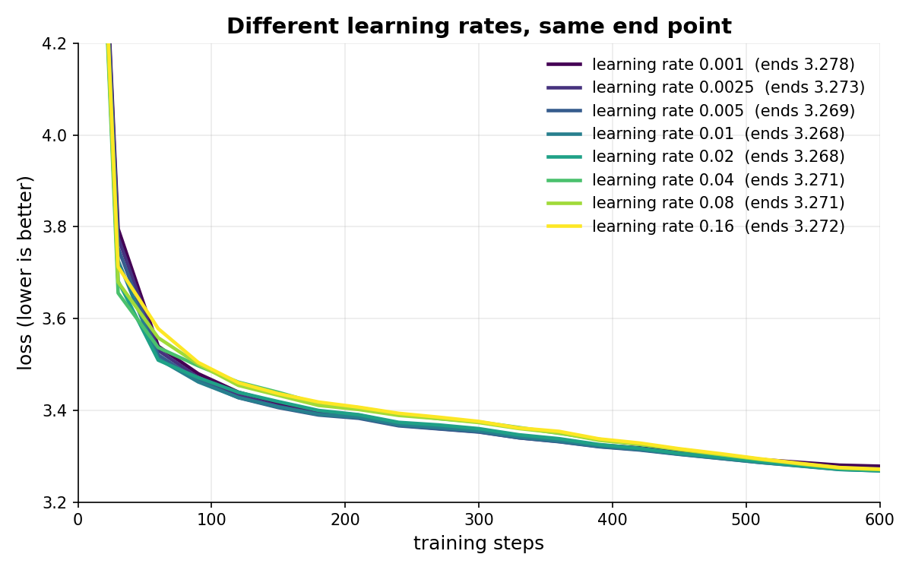

# Learning rate sets speed, not where the model ends up

The learning rate only decides how fast a model learns, not where it ends up.

Given enough training, the model will end up at the same place and learn the same things, unless the learning rate is too high.

Except if the data is highly repetitive. Then a larger learning rate will actually make it not memorize, and it will perform better (Li et al. 2019, on image models).

But big labs' LLMs stop training long before LLM learns everything from data, so for them the learning rate also decides how good the final model is.

Setup: 2-layer model, width 64, Muon, 600 steps on a simple token chain, one pass over the data, 3 seeds per learning rate. All 8 rates end between 3.268 and 3.278; two seeds at one rate differ by about 0.006. Code: [experiments/learning-rate](../experiments/learning-rate/) (`STEPS=600 python3 curve.py 0.02 0`).
