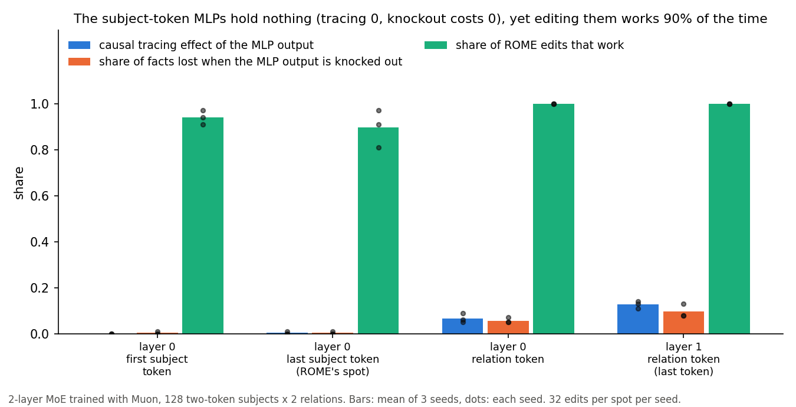

# An MLP edit works even where the fact is not stored

ROME finds where a fact lives with causal tracing, then rewrites the MLP there with a rank-one change. I trained a small model on 256 made-up facts ("subject + relation → object") and checked each MLP spot three ways: causal tracing, knocking the MLP output out, and a ROME edit.

1. The MLPs at the subject tokens hold nothing about the facts. Causal tracing gives them 0.00-0.01. Replacing their output with its average keeps 99-100% of facts right.

2. A ROME edit at those same MLPs still changes the answer in 90% of edits (81-97% across seeds). So an edit that works does not show the fact was stored there. The edit writes a new route to the answer next to the old one.

3. The facts move through attention. In layer 0, attention at the relation token reads the subject. Knocking that one attention output out leaves only 15-29% of facts right. Causal tracing gives it 0.56.

| spot (2-layer model) | tracing effect of the MLP | facts lost when the MLP is knocked out | ROME edits that work |
|---|---|---|---|
| layer 0, first subject token | 0.00 | 0-1% | 94% |
| layer 0, last subject token (ROME's spot) | 0.00 | 0-1% | 90% |
| layer 0, relation token | 0.07 | 5-7% | 100% |
| layer 1, relation token (last token) | 0.13 | 8-13% | 100% |

Example: for one subject the MLP output at its last token is replaced by the average output and the model still answers the right object. A rank-one change to that MLP's down matrix, built from that token's activation, then makes the model give a new object of our choice.

4. It holds with one-token subjects and the relation shown first (the toy's default fact task, 128 facts, seed 0). Each single MLP spot knocked out leaves 98-100% of facts right; the whole MLP in both layers leaves 86-87% (from 95-98%). ROME edits work 97-100% at every spot.

5. It also holds with 4× more facts (512 subjects), 8 relations, and with the embedding learning rate not raised. In none of these did the MLP become the main store within 260 steps.

## How to use this

Do not read a working edit as proof of where a fact is stored. Do not pick the edit layer from causal tracing either. To find where a fact lives, knock the spot out. To pick where to edit, measure what each candidate spot breaks (see [edit-the-last-token](edit-the-last-token.md)).

## What is new and what is not

[Hase et al. 2023](https://arxiv.org/abs/2301.04213) showed that tracing barely predicts which layer edits best in GPT-J: the layer number explains most of the edit success and tracing adds under 0.1%. [2601.04600](https://arxiv.org/abs/2601.04600) argues that ROME adds a competing signal instead of erasing the old fact. [Nichani, Lee and Bietti 2024](https://arxiv.org/abs/2412.06538) show facts can sit in attention as well as in MLPs. New here is a fully checkable case. The spot has zero tracing effect and zero knockout cost, so it provably stores nothing, and the edit still works 90% of the time. The model here is also an MoE trained with Muon. This is a 2-layer toy with 256 facts. Large models store facts in MLPs far more than this toy does.

## Data

Model: 2 layers, width 64, 4 heads, RoPE, QK-norm, SwiGLU, RMSNorm, MoE with 8 experts (top-2, hidden 88). Trained with Muon (Newton-Schulz, 5 steps) at lr 0.028 for 260 steps, batch 32, on 8 skills. The facts are 128 two-token subjects (from two 16-word pools) × 2 relations. Each prompt is [start, subject word 1, subject word 2, relation] → object, and each training sequence packs 3 facts. Facts right after training: 98/82%, 100/83%, 98/79% (seeds 0/1/2, common/rare objects).

Causal tracing (ROME's method): add noise of 3× the embedding scale to the subject tokens, restore one clean module output, and record the recovered share of the answer probability. The mean is over the 225-230 facts that are right and whose probability drops by more than 0.2 under the noise. Knockout: replace the module output at one spot with its mean over natural text. ROME edit: optimize the output change at the spot, then write it into the chosen expert's down matrix as W += d (C⁻¹k)ᵀ / (kᵀC⁻¹k), where C is the key second moment of that expert over natural text. The edit goes into the top-routed expert. Each seed has 32 edits per spot, each to a random new object.

Per seed (0 / 1 / 2), at the four spots in table order:
- tracing: 0.00 0.01 0.06 0.14 / 0.00 0.00 0.09 0.13 / 0.00 0.00 0.05 0.11
- knockout kept: 0.99 0.99 0.95 0.87 / 1.00 1.00 0.93 0.92 / 1.00 1.00 0.95 0.92
- edits working: 0.94 0.91 1.00 1.00 / 0.91 0.81 1.00 1.00 / 0.97 0.97 1.00 1.00
- layer-0 attention at the relation token, knockout kept: 0.29 / 0.15 / 0.26

Code: [facts.py](../experiments/fact-editing/facts.py) (`train`, `trace`, `edit`), [figure.py](../experiments/fact-editing/figure.py), numbers in [results.json](../experiments/fact-editing/results.json), notes in [NOTES.md](../experiments/fact-editing/NOTES.md).
