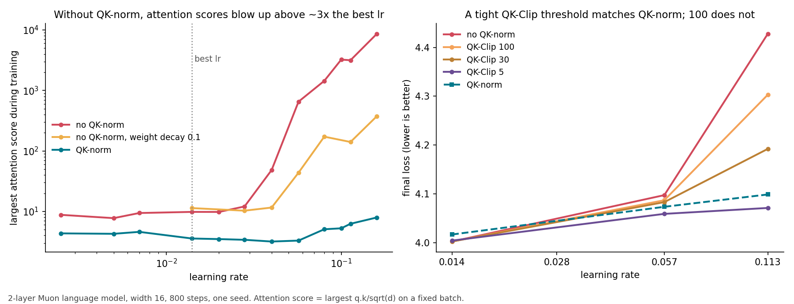

# Without QK-norm, Muon's attention scores blow up above a learning rate threshold

QK-norm normalizes each attention head's queries and keys before they are multiplied. Some models can't use it (for example DeepSeek's MLA attention, used by Kimi K2), so with the Muon optimizer they need another way to keep attention scores from growing.

1. Without QK-norm, the largest attention score stays near 10 up to about 3× the best learning rate, then jumps to hundreds or thousands.

At learning rate 0.028 the largest score is 12; at 0.04 it is 48; at 0.057 it is 653. Above the jump, loss gets worse fast: +0.33 at 8× the best learning rate.

2. At the best learning rate, QK-norm makes no difference. The best loss with and without it is within 0.02. QK-norm only matters when the learning rate is too high.

3. What moves the threshold:
- Momentum: higher momentum lowers it (0.055 / 0.040 / 0.029 at momentum 0.90 / 0.95 / 0.98).
- Depth: deeper models blow up sooner (at learning rate 0.04 the largest score is 34 / 73 / 94 with 2 / 4 / 8 layers). The first layer never blows up; the later layers go first.
- Weight decay 0.1 raises the threshold 1.5× and keeps the scores 8-20× smaller above it.
- Width (16 to 64) and training length (300 to 1,200 steps) barely move it.

4. QK-Clip (Kimi K2's fix: shrink a head's queries and keys whenever its largest score passes a threshold) works only if the threshold is tight. With threshold 100 the loss at 8× the best learning rate is still 0.20 worse than QK-norm. With threshold 5, about half the largest score at the best learning rate, it matches QK-norm (4.071 vs 4.099; second seed 4.088 vs 4.137) and costs nothing at the best learning rate.

5. Two other fixes don't replace QK-norm. Capping the scores inside the softmax (Gemma 2's soft-capping at 30) halves the damage at 8× the best learning rate (4.221 vs 4.428, QK-norm 4.099), and a tighter cap of 5 is worse (4.264), because the raw scores still grow to about 4,000 underneath. An output gate on attention (Qwen's gated attention) does nothing (4.432); the scores still reach 5,700.

How to use this

If you train with Muon and without QK-norm, keep the learning rate below about 2× your best one, and lower it more if you raise momentum or depth. Soft-capping and gating are not substitutes. If you use QK-Clip, set the threshold from the attention scores you see in a healthy run (around the largest score at the best learning rate), not a fixed 100.

What is new and what is not

Attention scores blowing up at high learning rates was shown for other optimizers by Wortsman et al. 2023, and for Muon at large scale by Kimi K2, which introduced QK-Clip and reported that soft-capping was not enough. I found no paper that measures where the Muon threshold sits relative to the best learning rate, how momentum, depth and weight decay move it, or how the QK-Clip threshold changes the result above it.

This is a tiny model with 4-dimensional heads, so the numbers (10, 5, 100) only make sense relative to each other. In Kimi K2 the scores grew at the normal learning rate during a very long run; these short runs only blow up above it.

## Data

Largest attention score (peak during training) and final loss, no QK-norm vs QK-norm, seed 0:

| learning rate | 0.007 | 0.014 | 0.028 | 0.04 | 0.057 | 0.08 | 0.113 | 0.16 |
|---|---|---|---|---|---|---|---|---|
| score, no QK-norm | 9.4 | 9.8 | 12 | 48 | 653 | 1441 | 3160 | 8662 |
| score, no QK-norm, weight decay 0.1 | | 11 | 10 | 12 | 44 | 172 | 141 | 376 |
| score, QK-norm | 4.6 | 3.6 | 3.4 | 3.2 | 3.3 | 5.1 | 6.2 | 7.9 |
| loss, no QK-norm minus QK-norm | -0.001 | -0.014 | -0.005 | 0.000 | +0.024 | +0.063 | +0.329 | +0.346 |

Threshold (learning rate where the largest score reaches 5× its value at 0.014) vs the best learning rate:

| setting | threshold | best learning rate | ratio |
|---|---|---|---|
| batch 4, 1,600 steps | 0.031 | 0.0073 | 4.3 |
| batch 8, 800 steps | 0.040 | 0.0094 | 4.3 |
| batch 32, 200 steps | 0.074 | 0.027 | 2.7 |
| width 16 / 32 / 64 | 0.043 / 0.043 / 0.043 | | |
| 300 / 800 / 1,200 steps | 0.050 / 0.040 / 0.042 | | |
| momentum 0.90 / 0.95 / 0.98 | 0.055 / 0.040 / 0.029 | | |

The threshold was at least 2× the best learning rate in all 9 settings. Seed 1 repeats the jump (12.8 at 0.028, 35 at 0.04, 382 at 0.057).

QK-Clip, final loss / largest score, no QK-norm, seed 0:

| threshold | learning rate 0.014 | 0.057 | 0.113 |
|---|---|---|---|
| none | 4.002 / 9.8 | 4.097 / 653 | 4.428 / 3160 |
| 100 | 4.002 / 9.8 | 4.087 / 120 | 4.303 / 141 |
| 30 | 4.002 / 9.8 | 4.083 / 44 | 4.192 / 45 |
| 10 | 4.002 / 9.8 | 4.064 / 15 | 4.157 / 24 |
| 5 | 4.004 / 6.3 | 4.059 / 8.2 | 4.071 / 14 |
| QK-norm instead | 4.017 / 3.6 | 4.073 / 3.3 | 4.099 / 6.2 |
| soft-cap 30 instead (score shown before the cap) | 4.003 / 9.8 | 4.065 / 690 | 4.221 / 4096 |
| soft-cap 5 instead | 4.005 / 9.4 | | 4.264 / 4149 |
| output gate instead | 4.015 / 25 | 4.105 / 599 | 4.432 / 5669 |

Setup: 2-layer model, width 16, 4 heads, batch 8, sequence length 32, RoPE, SwiGLU, RMSNorm, Muon with momentum 0.95 (Nesterov), no weight decay unless stated, 20 warmup steps, learning rate decayed to zero over the last half, 800 steps on a mix of 20 toy tasks. Attention score = largest q·k/√d on a fixed batch, checked every 50 steps. QK-Clip here rescales a head's query and key weights by √(threshold / score) after each step, on all dimensions (Kimi K2 treats the shared RoPE part of MLA separately). One seed per point unless stated; loss noise between seeds is about 0.01-0.02. Each run takes about 2.5 s on a laptop CPU. Code: [experiments/muon-attention-logits](../experiments/muon-attention-logits/) (`QKNORM=0 python3 attn.py 0.014,0.057 0`) [experiments/muon-qkclip](../experiments/muon-qkclip/) (`QKNORM=0 QKCLIP=5 python3 attn.py 0.113 0`) and [experiments/muon-attn-fixes](../experiments/muon-attn-fixes/) (`QKNORM=0 SOFTCAP=30 python3 attn.py 0.113 0`, `GATE=1` for the gate).
