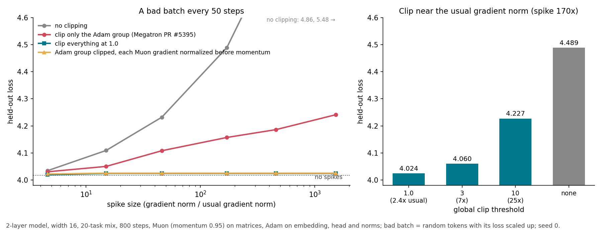

# Keep gradient clipping on for Muon, with a low threshold: one huge gradient steers its momentum for dozens of steps

Muon's Newton-Schulz step throws away the size of the momentum, so people argue global gradient clipping does nothing for Muon matrices and should only clip the Adam group (embedding, head, norms). Megatron-LM has an open change that does this ([PR #5395](https://github.com/NVIDIA/Megatron-LM/pull/5395)). I fed the same model a bad batch (random tokens, loss scaled up) every 50 steps and compared clipping choices.

1. Clipping only the Adam group loses most of what clipping protects. With bad batches 170× the usual gradient norm, mean of 3 seeds:

| clipping | held-out loss |
|---|---|
| no bad batches | 4.029 |
| clip everything at 0.2 (half the usual gradient norm) | 4.026 |
| clip everything at 1.0 (2.4× the usual norm) | 4.037 |
| clip only the Adam group (PR #5395) | 4.158 |
| Adam group clipped, each Muon gradient divided by its own norm before momentum | 4.038 |
| no clipping | 4.49 (seed 0) |

2. The cost grows with the spike. Adam-only clipping is +0.03 at spikes 15× the usual norm, +0.09 at 46×, +0.17 at 457×, +0.22 at 1,520×; clipping everything stays within 0.01 of the clean run at every size.

3. Why: the orthogonalization sees the momentum, not one gradient. A gradient S× the usual one dominates the momentum for about ln(S)/(1−β) steps (90 steps for S=100, β=0.95), and every one of those steps is a full-size step in the bad batch's direction. With momentum off, Adam-only clipping and clipping everything give the same loss (4.0513 both), so the whole effect goes through momentum.

4. It holds at width 32 with 8 heads (clean 3.881, clip all 3.882, Adam-only 4.017, normalize 3.891), with 4 layers (3.987 / 3.997 / 4.172 / 3.987) with momentum 0.98 (4.020 / 4.027 / 4.172 / 4.031), and with 3× longer training, 2,400 steps (clean 3.895, clip everything at 0.2 3.897, at 1.0 3.897, Adam-only 3.989; seed 0). One single 170× spike at step 400 of 800 costs +0.015 under Adam-only clipping and nothing with either fix.

5. It holds in a mixture-of-experts model (8 experts, top-2, 8 skills, 260 steps, a bad batch every 26 steps, 170×), mean of 3 seeds: no bad batches 2.683, clip everything at 0.5 (half the usual norm) 2.722, clip everything at 2 (1.8× the usual norm) 2.769, clip only the Adam group 3.275, Adam group clipped + each Muon gradient normalized 2.756, no clipping 5.12 (seed 0).

6. Lower thresholds are better, even below the usual gradient norm (0.41 here), seed 0 with spikes: threshold 0.1 gives 4.015, 0.2 gives 4.015, 1.0 gives 4.024, 3 gives 4.060, 10 gives 4.227. A threshold below the usual norm clips every step, which costs nothing on clean data because Muon and Adam both ignore the overall gradient size: 4.025 vs 4.029 unclipped (3 seeds, threshold 0.2), and 2.671 vs 2.683 in the MoE model (threshold 0.5). Going far lower is safe: a threshold of 0.001 (every step's gradient rescaled to a tiny norm) gives 4.024 clean and 4.027 with spikes (3 seeds), and in the MoE model thresholds 0.001 / 0.1 / 0.5 give 2.735 / 2.732 / 2.722 with spikes, so the threshold only has to be below the usual norm. Going lower gains nothing, and has one limit: Newton-Schulz code that normalizes with `eps=1e-7` (Emerging-Optimizers, used by Megatron) stops producing an orthogonal update once a matrix's momentum norm falls below about 1e-8 ([issue #229](https://github.com/NVIDIA-NeMo/Emerging-Optimizers/issues/229)), so keep the threshold near half the usual norm rather than orders of magnitude below it.

How to use this

If you train with Muon, keep global gradient clipping over all parameters, Muon matrices included, and set the threshold at or below the usual gradient norm (half the median worked in both toys), not the default 1.0 if your gradient norm runs well below 1. If you want Muon out of the clipping, divide each Muon matrix's gradient by its own Frobenius norm before adding it to the momentum (one line, no threshold, no cost on clean data in either toy: 4.027 vs 4.029, and 2.676 vs 2.683 in the MoE model); this also avoids the Newton-Schulz eps-floor stall that motivated the Megatron change.

What is new and what is not

Megatron PR #5395 (open) clips only non-Muon parameters, motivated by a stall in Qwen3.5-35B-A3B fine-tuning ([Emerging-Optimizers issue #229](https://github.com/NVIDIA-NeMo/Emerging-Optimizers/issues/229)). MuonQ ([2605.11396](https://arxiv.org/abs/2605.11396)) normalizes gradient and momentum and reports no change on clean data. SPAM ([2501.06842](https://arxiv.org/abs/2501.06842)) and MVN-Grad ([2602.10204](https://arxiv.org/abs/2602.10204)) study gradient spikes for Adam-type optimizers. AdaGC ([2502.11034](https://arxiv.org/abs/2502.11034)) and ZClip ([2504.02507](https://arxiv.org/abs/2504.02507)) set clip thresholds from running gradient-norm averages; Musec ([2609.11655](https://arxiv.org/abs/2609.11655)) clips the momentum's large singular values instead of flattening them all. Some Muon recipes train with clipping off. I found no paper that measures spikes with and without clipping under Muon.

This is a 2-layer toy and the spikes are injected: natural bad batches here (random tokens, or one repeated token) were only 1.6× and 5× the usual norm and cost ≤0.01. Large runs report loss spikes with gradient norms tens to hundreds of times normal; whether those last long enough in momentum to matter at scale is not measured.

## Data

Loss = mean held-out loss over 20 tasks, lr 0.014 (best), clip threshold 1.0, seeds 0 / 1 / 2.

No bad batches: none 4.0167 / 4.0406 / 4.0285; clip all 4.0164 / 4.0406 / 4.0285; normalize 4.0074 / 4.0433 / 4.0308.

Bad batch every 50 steps, loss ×100 (170× usual norm): clip all 4.0240 / 4.0396 / 4.0473; Adam-only 4.1568 / 4.1712 / 4.1450; Adam-only + normalize 4.0250 / 4.0492 / 4.0410. Seed 0: none 4.4889, Muon-only clip 4.4370, normalize with no clip 4.4348.

Spike size, seed 0 (loss scale 3 / 10 / 30 / 300 / 1000 = 4.6 / 15 / 46 / 457 / 1520× usual norm), none | Adam-only | all | Adam-only + normalize: 4.0343 4.1093 4.2317 4.8594 5.4839 | 4.0303 4.0495 4.1079 4.1860 4.2412 | 4.0188 4.0240 4.0240 4.0240 4.0240 | 4.0216 4.0250 4.0249 4.0249 4.0250. Seeds 1 / 2 at scale 30: Adam-only 4.1185 / 4.1104, all 4.0396 / 4.0473, none 4.32 / 4.29; at scale 300: Adam-only 4.1944 / 4.1704, all 4.0396 / 4.0473, normalize 4.0492 / 4.0410, none 4.90 / 4.92.

Clip 0.2 (seeds 0 / 1 / 2): no bad batches 4.0127 / 4.0372 / 4.0249; bad batches ×100 4.0146 / 4.0345 / 4.0286. Seed 0: clip 0.1 4.0127 clean, 4.0146 with bad batches; clip 0.2 with ×1000 bad batches 4.0148. Clip 0.001 (seeds 0 / 1 / 2): no bad batches 4.0112 / 4.0370 / 4.0249; bad batches ×100 4.0145 / 4.0350 / 4.0325.

Single spike at step 400: none 4.0707, Adam-only 4.0323, all 4.0171, normalize 4.0070. Momentum 0: clean 4.0487, all 4.0513, Adam-only 4.0513.

MoE model (seeds 0 / 1 / 2): no bad batches 2.668 / 2.692 / 2.688; clip everything 2.762 / 2.779 / 2.766; Adam-only 3.240 / 3.273 / 3.313; Adam-only + normalize 2.738 / 2.778 / 2.753. Normalize with no bad batches 2.676 / 2.693 / 2.658. Clip 0.5: no bad batches 2.662 / 2.690 / 2.661, bad batches 2.706 / 2.732 / 2.728. Clip 0.001: no bad batches 2.669 / 2.681 / 2.652, bad batches 2.741 / 2.737 / 2.727; clip 0.1 with bad batches 2.740 / 2.734 / 2.721. Seed 0: clip 2 with no bad batches 2.677, no clipping 5.120. Usual gradient norm there: median 1.12.

Setup: 20-task mix (algorithmic tasks and token chains), 2 layers, width 16, 4 heads, RoPE, QK-norm, SwiGLU, RMSNorm, no biases. Muon (5-step Newton-Schulz, momentum 0.95 Nesterov) on attention and MLP matrices, Adam on embedding, head and norms. Batch 8, 800 steps, 20 warmup steps, lr decayed to zero over the last half. Bad batch at step i when i mod 50 = 25 and i < 720. About 3 s per run on a laptop CPU. Code: [experiments/muon-grad-spikes](../experiments/muon-grad-spikes/) (`CLIP=1 CLIPON=adam SPIKE_EVERY=50 SPIKE_SCALE=100 python3 attn.py 0.014 0`; `CLIPON=all|muon|adam`, `PRENORM=1`, `SPIKE_KIND=rand|rep`; chart `figure.py`). MoE model: the default toy in `muon/toy-suite` (2 layers, width 64, 8 SwiGLU experts top-2, 8 skills, lr 0.014, Muon on attention and expert matrices, each expert orthogonalized alone): `MOE=8 MSIGN=ns EMB_MULT=8 SPIKE_EVERY=26 SPIKE_SCALE=100 CLIP=2 CLIPON=adam python3 sampled.py full 0 260 0.014`.
