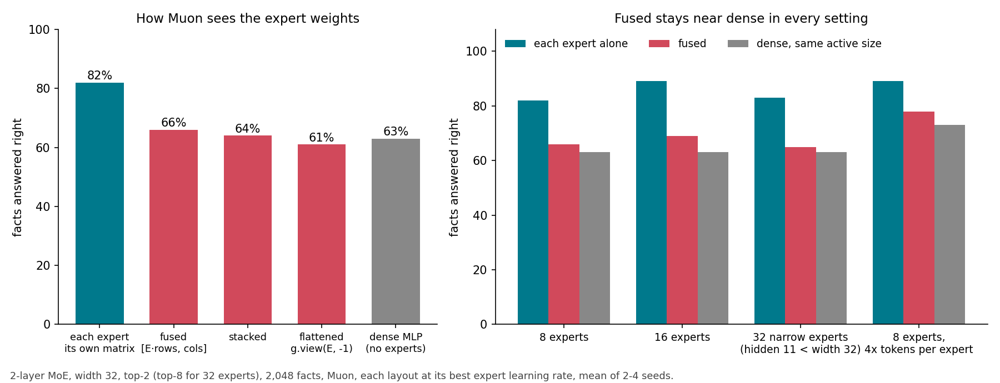

# With Muon, orthogonalize each expert alone: treating the experts as one matrix loses most of the MoE gain

Expert weights are often stored as one tensor (8 experts × out × in, or fused into one 2D matrix of 8·out rows). Muon has to be told where one expert ends. I trained the same mixture-of-experts model four ways and compared it with a dense model of the same active size.

1. Orthogonalizing each expert's matrix on its own keeps the full MoE gain. Every other layout loses 75-100% of it, even with its expert learning rate tuned.

| how Muon sees the expert weights | facts right | facts loss |
|---|---|---|
| each expert its own matrix | 82% | 0.848 |
| fused: all experts stacked into one tall matrix | 66% | 1.405 |
| stacked (up/gate by rows, down side by side) | 64% | 1.473 |
| flattened: each expert one row (`g.view(g.size(0), -1)`) | 61% | 1.592 |
| dense MLP, same active size (no experts) | 63% | 1.564 |

2. The gap grows with more experts. With 16 experts: 89% right on its own (loss 0.517), 69% fused (1.30). With 32 narrow experts, top-8, each expert's hidden size (11) smaller than the model width (32) as in DeepSeek-V3 and Kimi K2: 83% on its own (0.79), 65% fused (1.42 at its best expert learning rate).

3. It holds at width 64 (4,096 facts): dense 1.92, each expert alone 1.41, fused 1.79.

4. It holds when each expert sees 4× more tokens per step (batch 128 instead of 32, about 512 tokens per expert per step): dense 73% right (loss 1.14), each expert alone 89% (0.54), fused 78% (0.98), each at its best learning rate.

5. It is not about how many tokens each expert got. Scaling each expert's step by its share of tokens (power 0.5, 1 or −0.5) changes nothing (0.79-0.84), because load balancing keeps the shares nearly equal anyway. What the fused layout breaks is the per-expert whitening: a stacked matrix with 32 input columns has a rank-32 update in total, so the 8 experts split one set of directions between them instead of each getting its own full-rank update fitted to the tokens it sees.

How to use this

If you train an MoE with Muon, check that the Newton-Schulz step runs on each expert's matrix separately (a batched 3D call over experts is fine). If your expert weights are stored fused (`[E·rows, cols]`) or your Muon flattens tensors with more than 2 dimensions, the run will still train and look normal, but it will end up close to a dense model.

What is new and what is not

Frameworks handle this case by case: XTuner keeps a per-expert batch path for fused `[E·rows, cols]` weights ([PR 2161](https://github.com/InternLM/xtuner/pull/2161)), NeMo Automodel splits grouped experts per matrix and leaves them off Muon when flattened ([PR 4114](https://github.com/NVIDIA-NeMo/Automodel/pull/4114)), Motif 3 batches Newton-Schulz per expert ([2608.09119](https://arxiv.org/abs/2608.09119)), and Moonlight's example Muon flattens tensors above 2D with `g.view(g.size(0), -1)` (behind an assert that only allows 2D). ExpertMuon-Compass ([2610.04140](https://arxiv.org/abs/2610.04140)) rescales per-expert steps and reports gains of about 0.003. I found no paper that measures what the wrong layout costs.

This is a 2-layer toy with 2,048 facts, where facts need the extra expert memory (dense gets 63%). The rank argument says big models lose more, not less: here the fused layout gives the 8 experts 32 directions in total instead of 8 × 32, 8× fewer; with DeepSeek-V3's shapes (256 experts of 2,048 × 7,168) fused gate/up weights would get 7,168 directions instead of 256 × 2,048, about 70× fewer. This is not measured at scale.

## Data

Loss on the fact answers, held out sequences of the same facts, lr 0.02, seeds 0-3 (dense, each, fused, flat, stacked) or 0-1 (the rest).

Per seed: each expert alone 0.775 / 0.751 / 0.980 / 0.886; fused (expert lr ×0.5) 1.369 / 1.325 / 1.423 / 1.504; stacked (×0.5) 1.565 / 1.377 / 1.504 / 1.446; flat (×2) 1.597 / 1.448 / 1.628 / 1.697; dense 1.622 / 1.464 / 1.608 / 1.560.

Expert lr multiplier, seeds 0 | 1: each ×0.5 1.038 | 1.118, ×1 0.775 | 0.751, ×2 1.061 | 1.200; fused ×0.25 1.575 | 1.519, ×0.5 1.369 | 1.325, ×1 1.485 | 1.537; stacked ×0.25 1.705 | 1.635, ×0.5 1.565 | 1.377, ×1 1.469 | 1.492, ×2 2.139 | 2.279; flat ×1 1.845 | 1.573, ×2 1.597 | 1.448, ×4 1.616 | 1.473, ×8 2.824 | 2.471, ×16 diverges.

Batch 128, 150 steps, 8 warmup steps (seeds 0 | 1 at lr 0.04): dense 1.049 | 1.234, each 0.502 | 0.572, fused ×1 0.936 | 1.028; seed 0: lr 0.028 dense 1.220, each 0.586; lr 0.08 dense 1.148, each 0.801, fused ×0.5 1.184, ×1 1.302; lr 0.04 fused ×0.5 1.178, ×2 1.562.

32 experts top-8, expert hidden 11, lr 0.02, seeds 0 | 1: each 0.800 | 0.785; fused ×0.25 1.469 | 1.483, ×0.5 1.343 | 1.500, ×1 1.437 | 1.647.

16 experts (same active size), seeds 0 | 1: each 0.533 | 0.501; fused ×0.25 1.355 | 1.271, ×0.5 1.229 | 1.365. Width 64, 4,096 facts, seed 0: dense 1.917, each 1.410, fused ×0.5 1.788, ×1 2.198.

Setup: task "facts" = [subject, relation, answer, relation, answer, ...], 256 subjects × 8 relations, 256 answer words; attention must carry the subject from the first position and the MLP must store the facts. Half the sequences are a copy task. 2 layers, width 32, 4 heads, RoPE, QK-norm, SwiGLU, RMSNorm, no biases; MoE = 8 SwiGLU experts, top-2, expert hidden size half the dense one (same active size), softmax router, DeepSeek-V3 bias load balancing. Muon (5-step Newton-Schulz, momentum 0.95 Nesterov, step × max(1, rows/cols)^0.5) on attention and expert matrices; Adam on embedding (lr ×8), head (×8), norms and router. Batch 32, length 16, 400 steps, 20 warmup steps, lr decayed to zero over the last half. 3.9 s per MoE run on a laptop CPU. Code: [experiments/moe-attn](../experiments/moe-attn/) (`NS=256 MOE=8 MUON_EXP=fused EXP_MULT=0.5 python3 moe.py 0.02 0`; `MUON_EXP=each|fused|stack|flat`).
