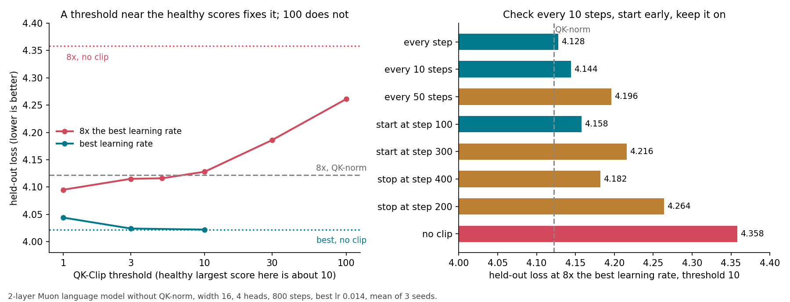

# When Muon needs QK-Clip, and how to set it

QK-Clip (Kimi K2) shrinks a head's query and key weights whenever its largest attention score passes a threshold τ. Kimi K2 uses τ = 100 for every head. I measured when the clip is needed at all, which τ works, and which implementation details matter, on a small Muon model without QK-norm.

1. At the normal learning rate on mixed data, the clip is not needed, even in long runs. The largest score grows with training length (9.8 / 27 / 45 at 800 / 3,200 / 8,000 steps), but clipping it to 10 or 30 changes the loss by at most 0.002.

2. Large scores are not the same as damage. A score of 386 cost 0.003 loss; damage starts when scores reach the thousands, which here happens only above about 4× the best learning rate.

3. τ = 100 is enough up to about 4× the best learning rate and not above. At 4× (3,200 steps) τ = 100, 30 and 10 all give the same loss (3.912 / 3.908 / 3.908, QK-norm 3.898). At 8× τ = 100 recovers only a third of the damage, and a τ near the healthy scores recovers all of it:

| τ | none | 100 | 30 | 10 | 5 | 3 | QK-norm instead |
|---|---|---|---|---|---|---|---|
| loss at 8× the best learning rate | 4.358 | 4.261 | 4.186 | 4.128 | 4.116 | 4.115 | 4.122 |
| loss at the best learning rate | 4.022 | | | 4.022 | | 4.024 | 4.029 |

A tight τ costs nothing at the best learning rate (τ = 3 costs 0.002), because healthy heads rarely reach it.

In longer runs the threshold matters less. At 8,000 steps and 8× the best learning rate, τ = 5, 10, 20 and 100 all give the same loss (3.858-3.861, no clip 3.912, QK-norm 3.842, seed 0). At 3,200 steps τ = 100 was fine on one seed and left 0.15 on the other, while τ = 10-20 was fine on both.

If you set a tighter τ, measure the typical head, not the largest one. The largest score in a healthy run is set by one or two outlier heads (37 vs 3-8 for the other seven heads at 8,000 steps), and varies 8-62 across 13 model shapes. The median head's largest score stays at 5-9 in all of them, for widths 16-64, head sizes 4-32, depth 2-4 and momentum 0.95-0.98. τ = 1-1.5× that median is within 0.04 of QK-norm at 8× the best learning rate in every shape. Going below the median costs a little at the best learning rate: +0.005 to +0.017 for τ = 5 when the median is 7-8.

4. Check every 10 steps, start at step 0, never stop while the learning rate is high. At 8× the best learning rate with τ = 10:
- checking every 10 steps costs 0.016 (0.003 at τ = 5) and needs 6× fewer clips; every 50 steps costs 0.07
- starting the clip at step 300, after scores reached 1,400, still rescues most of the loss (4.216 vs 4.358 unclipped), so it works as a rescue for a run that is already blowing up
- stopping the clip at step 200 lets scores grow back to 1,900-2,800 and costs 0.14; stopping at step 400 costs 0.05

5. These details do not matter (all within 0.03 loss, 3 seeds): one clip per head vs one per layer, how the shrink is split between queries and keys, scores from the training batch vs a fixed batch.

6. Weight decay 0.1 or a 200-step warmup removes most of the need. Each alone brings the 8× run from 4.358 to 4.152 / 4.156, and then τ = 100 does nothing (it rarely fires); τ = 10 still adds 0.03-0.07.

7. Data made only of copy or lookup tasks blows up at the best learning rate (largest score 349 on pure copying, 40-115 on sort, reverse, count and modular addition). Mixing in 50% ordinary data brings it down to 7-17.

8. On copying data QK-Clip cannot replace QK-norm. QK-norm wins by 0.15-0.34 even at learning rates where scores stay small (22-58), so the gap does not come from large scores; every τ from 100 down to 5 makes it worse (τ = 5: +0.33). Normalizing only the keys gives the same benefit.

9. Extra weight decay on only the query and key weights does the clip's job with no score tracking. With decay 0.3 on W_q and W_k and none elsewhere, the loss at 8× the best learning rate is 4.116 (QK-Clip τ = 10: 4.128, QK-norm 4.122, 3 seeds) and the cost at the best learning rate is 0.000. It also works at 12× (4.212, decay 1: 4.187, QK-norm 4.153, no clip 4.523), at width 32 with 8 heads (3.956 vs QK-norm 3.967), and on pure copying data at 0.3. In 8,000-step runs it still equals QK-Clip at 8× (3.874 vs 3.870, 3 seeds) but costs 0.010 at the best learning rate, where QK-Clip costs nothing. Too much hurts like a too-tight clip: decay 1 costs 0.38 on copying data.

How to use this

If you train with Muon without QK-norm at a normal learning rate on a broad data mix, QK-Clip is insurance, not a fix: τ = 100 is fine. If you push the learning rate several times above the best one, or a run is already blowing up, set τ to about 1-1.5× the median head's largest score in a short healthy run instead of 100, check every 10 steps, and keep the clip on as long as the learning rate is high. If you cannot track the largest score inside your attention kernel, weight decay of about 0.3 on only the query and key weights is a one-line substitute, at a cost of about 0.01 in long runs. If part of your training is mostly copying or retrieval data, use QK-norm on at least the keys; clipping will not get that loss back.

What is new and what is not

Kimi K2 ([2507.20534](https://arxiv.org/abs/2507.20534)) introduced QK-Clip with τ = 100 and reported that scores sit at the cap early and then stop needing it. [2511.21377](https://arxiv.org/abs/2511.21377) lowers the query and key learning rates instead of clipping and reports QK-Clip becoming unstable at high learning rates, which matches τ = 100 failing at 8× here. [2606.16310](https://arxiv.org/abs/2606.16310) makes QK-norm possible for MLA. I found no paper that uses weight decay on only the query and key weights for this. I found no paper that sweeps τ, gives a rule for setting it, or measures how often to check, when to start or stop, or which data makes the clip necessary.

This is a 2-layer model with 4-dimensional heads, so the scores (10, 100, 349) only make sense relative to each other: τ = 100 here is 10× the healthy score, and a big model's healthy scores are larger. Kimi K2 clips the shared RoPE part of MLA differently; here every dimension is clipped.

## Data

All losses are held-out, mean of seeds 0-2 unless stated. "8×" is learning rate 0.113, "best" is 0.014.

Clip schedule at 8×, τ = 10: every step 4.128, every 10 steps 4.144, every 50 steps 4.196, fixed batch every step 4.131, start at step 100 4.158, start at step 300 4.216, stop at step 200 4.264, stop at step 400 4.182; no clip 4.358. τ = 5: every step 4.116, every 10 steps 4.119, one per layer 4.108.

Weight decay and warmup at 8× (loss / largest score): no clip 4.358 / 3,791; warmup 200 4.156 / 2,177; weight decay 0.1 4.152 / 166; with τ = 100: 4.261 / 145, 4.113 / 136, 4.158 / 122; with τ = 10: 4.128 / 19.5, 4.085 / 16.7, 4.124 / 16.

Long runs, seed 0, loss / largest score:

| steps | learning rate | no clip | τ = 100 | τ = 30 | τ = 10 | QK-norm |
|---|---|---|---|---|---|---|
| 800 | 0.014 | 4.002 / 9.8 | | | | 4.017 / 3.6 |
| 3,200 | 0.014 | 3.869 / 27 | | | | 3.866 / 4.4 |
| 8,000 | 0.014 | 3.826 / 45 | | 3.826 / 32 | 3.824 / 11 | 3.804 / 6.7 |
| 3,200 | 0.04 | 3.901 / 386 | 3.895 / 113 | | | 3.898 / 3.2 |
| 3,200 | 0.057 | 3.956 / 4,333 | 3.912 / 137 | 3.908 | 3.908 | 3.898 / 6.6 |

Data mix, seed 0, largest score at the best learning rate (no clip): full 20-task mix 9.8; copying only 349; sort / reverse / count / modular addition alone 40 / 99 / 90 / 90; all four together 115; 16 Markov chains only 6.1; copying + 1 chain (50/50) 7; count + 1 chain 17. On copying only, seed 0, loss at learning rate 0.0035 / 0.007 / 0.014: no QK-norm 3.605 / 3.526 / 3.251, QK-norm 3.456 / 3.190 / 3.052; at 0.014 τ = 100 / 30 / 10 / 5 give 3.313 / 3.417 / 3.522 / 3.585. Keys only normalized, seeds 0 | 1 at 0.007: 3.035 | 3.261 (both 3.190 | 3.401, queries only 3.562 | 3.533, none 3.526 | 3.553).

Setup: 2-layer model, width 16, 4 heads, batch 8, sequence length 32, RoPE, SwiGLU, RMSNorm, no QK-norm unless stated, Muon with momentum 0.95 (Nesterov), no weight decay unless stated, 20 warmup steps, learning rate decayed to zero over the last half, 800 steps on a mix of 20 toy tasks unless stated. Largest score = largest q·k/√d. QK-Clip rescales a head's query and key weights by √(τ / score) after each step, using the training batch's scores unless stated. Each 800-step run takes about 2.5 s on a laptop CPU. Code: [experiments/qkclip-shape](../experiments/qkclip-shape/) (`D=32 HEADS=8 QKNORM=0 QKCLIP=7 python3 attn.py 0.113 0`, `python3 tau.py` for the table), [experiments/qkclip-variants](../experiments/qkclip-variants/) (`QKNORM=0 QKCLIP=10 CLIPEVERY=10 python3 attn.py 0.113 0`), [experiments/qkclip-long](../experiments/qkclip-long/) (`STEPS=8000`, `CLIPSTOP=200`), [experiments/qkclip-data](../experiments/qkclip-data/) (`TASKS=...`), [experiments/qkclip-temp](../experiments/qkclip-temp/) (`QKNORM=4` keys only), [experiments/qkclip-batch](../experiments/qkclip-batch/) (`QKNORM=0 WDQK=0.3 python3 attn.py 0.113 0`, results in `wdqk.jsonl`, `wdqk_data.jsonl`).
