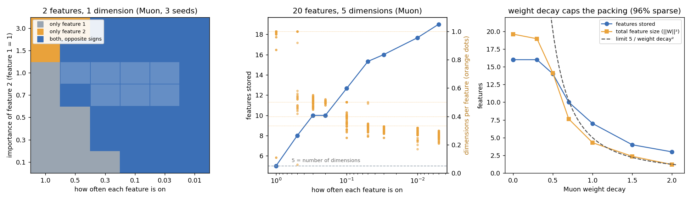

# Muon packs features the same way, and weight decay sets how many fit

**Claim:** the classic superposition toy behaves the same when trained with Muon. With 5 dimensions it stores 5 features when they are always on and up to 19 of 20 when each feature is on only 0.5% of the time, packed into the same shapes (pairs, triangles, pentagons). The same holds for the phase diagram of 2 features in 1 dimension. Muon's decoupled weight decay adds one thing: it caps the layer's largest singular value at about 1/wd, so a stronger decay leaves room for fewer features. Status: proven (3 seeds; the paper's toy, not an LLM).

**Example:** 20 features, 5 dimensions, importance 0.9^i, Muon lr 0.04, 3,000 steps:
- Each feature on 3% of the time: 16 features stored (3 of 3 seeds). Their dimensionalities sit on the paper's sticky values 1, 1/2, 1/3, 2/5 and about 2/7.
- Add weight decay 1.0 and it drops to 7 stored features, with the top singular value at 1.07-1.12 against a cap of 1/wd = 1. At wd 2 it drops to 3 features, top singular value 0.54-0.55, cap 0.5.

| how often a feature is on | 100% | 50% | 20% | 10% | 3% | 0.5% |
|---|---|---|---|---|---|---|
| features stored (of 20, in 5 dims) | 5 | 8 | 10 | 13 | 16 | 19 |

| Muon weight decay (features on 3%) | 0 | 0.3 | 0.5 | 0.7 | 1 | 1.5 | 2 |
|---|---|---|---|---|---|---|---|
| features stored (3 seeds) | 16, 16, 16 | 16 | 14, 14, 14 | 10, 10, 10 | 7, 7, 7 | 4, 4, 4 | 3, 3, 3 |
| top singular value | 2.00 | 1.97 | 1.72-1.74 | 1.29-1.30 | 1.07-1.12 | 0.72-0.75 | 0.54-0.55 |
| cap 1/wd | - | 3.3 | 2 | 1.4 | 1 | 0.67 | 0.5 |

Why the cap sets the count: a stored feature needs a weight vector of length about 1. If every singular value is at most 1/wd, the squared size of the whole 5-dimension matrix is at most 5/wd², so at wd 1 there is room for about 5 unit features plus a few weaker ones (7 here), and at wd 2 for about 1-3.

Phase diagram (2 features in 1 dimension, 3 seeds): when both features are often on, the model keeps only the more important one. When both are rare, it stores both as an opposite pair (+1 and -1 on the same line). The less important a feature is, the rarer it must be to get stored: at 10% of the first feature's importance it needs to be on 10% of the time or less, at 70-150% it needs 50% or less. This is the paper's boundary.

**What this builds on:** [Toy Models of Superposition](https://transformer-circuits.pub/2022/toy_model/index.html) (Elhage et al. 2022, [arXiv 2209.10652](https://arxiv.org/abs/2209.10652)): the toy, the sparsity sweep, the sticky dimensionalities and the phase diagram. The 1/wd bound on Muon's singular values comes from [Chen et al. 2025](https://arxiv.org/abs/2506.15054). **New here:** the toy trained with Muon (the paper used a different optimizer). Muon's whitened updates give the same geometry and the same counts. The weight-decay cap is turned into a feature count: at most about (dims)/wd² unit features fit in a Muon layer, which matches the measured 16 -> 3 features as wd goes 0 -> 2.

Code: [experiments/superposition](../experiments/superposition/) (`tms.py`, `phase.py`, `figure.py`).
