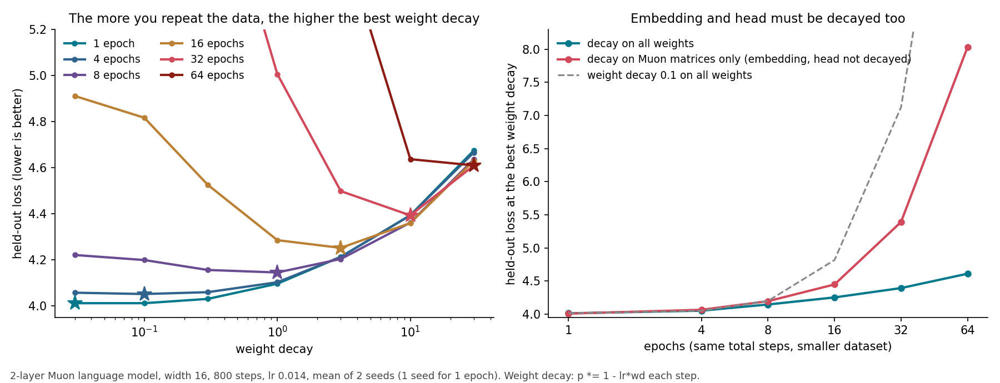

# Repeating data with Muon needs much higher weight decay

When a lab runs out of fresh text, it trains on the same data several times (several epochs). I measured how Muon's best weight decay changes with the number of epochs, with the total number of training steps kept the same.

1. Up to 4 epochs, the usual weight decay of 0.1 is right. Above that, the best weight decay grows about as fast as epochs^1.5.

| epochs | 1 | 4 | 8 | 16 | 32 | 64 |
|---|---|---|---|---|---|---|
| best weight decay | 0.03 | 0.1 | 1 | 3 | 10 | 10-30 |

Keeping 0.1 costs 0.05 loss at 8 epochs, 0.57 at 16, and 2.7 at 32.

2. Decay the embedding and the output head too, not only the Muon matrices. If only the Muon matrices are decayed, the embedding and head memorize the repeated data: at the best weight decay the loss is 0.20 worse at 16 epochs and 1.0 worse at 32.

How to use this

If you train with Muon on data repeated more than 4 times, raise weight decay to about 0.1 × (epochs ÷ 4)^1.5 and apply it to every weight matrix, including embedding and head. Then check one value above and one below, because the right number depends on how your code scales weight decay.

What is new and what is not

Papers already show that repeated data needs higher weight decay, for Adam-type optimizers: "Datasets, Documents, and Repetitions" ([2503.07879](https://arxiv.org/abs/2503.07879)) suggest scaling it by about √epochs on a 12.6B model, and [2606.06888](https://arxiv.org/abs/2606.06888) finds the best value far above 0.1 when data is scarce. Here the best weight decay grows much faster than √epochs, so the √epochs rule may be too gentle for Muon; this needs a check on a bigger model. I found no paper that measures this for Muon.

Many Muon setups and recipes leave the embedding and head without weight decay. That is fine for one epoch (no difference here) but costs a lot once data repeats.

This is a tiny model where 64 epochs means only 100 different training sequences, so only the trend transfers, not the exact numbers. Doubling the learning rate did not move the best weight decay, so the rule is not simply "keep learning rate × weight decay fixed" here.

## Data

Held-out loss, weight decay on all weights, mean of seeds 0 and 1 (seed 0 only for 1 epoch):

| epochs \ weight decay | 0 | 0.03 | 0.1 | 0.3 | 1 | 3 | 10 | 30 |
|---|---|---|---|---|---|---|---|---|
| 1 | 4.017 | **4.012** | **4.012** | 4.030 | 4.096 | 4.213 | 4.393 | 4.675 |
| 4 | 4.064 | 4.057 | **4.051** | 4.059 | 4.103 | 4.213 | 4.393 | 4.666 |
| 8 | 4.249 | 4.221 | 4.199 | 4.156 | **4.145** | 4.203 | 4.361 | 4.636 |
| 16 | 4.974 | 4.911 | 4.817 | 4.525 | 4.285 | **4.252** | 4.360 | 4.630 |
| 32 | 8.059 | 7.663 | 7.125 | 6.033 | 5.006 | 4.498 | **4.393** | 4.609 |
| 64 | 17.63 | 16.08 | 13.31 | 9.975 | 7.428 | 5.613 | 4.637 | **4.610** |

Weight decay on Muon matrices only, seed 0, best value: 4.007 / 4.065 / 4.195 / 4.448 / 5.391 / 8.034 at 1 / 4 / 8 / 16 / 32 / 64 epochs.

At learning rate 0.028 (seed 0) the best weight decay was 1-3 at 16 epochs and 10-30 at 64, the same as at 0.014.

Setup: 2-layer model, width 16, batch 8, sequence length 32, RoPE, QK-norm, SwiGLU, RMSNorm, Muon with momentum 0.95 (Nesterov), learning rate 0.014, 20 warmup steps, learning rate decayed to zero over the last half, 800 steps on a mix of 20 toy tasks. For E epochs the training set is 6,400/E sequences, each seen E times; loss is measured on separate held-out sequences. Weight decay is applied as p ← p × (1 − lr × wd) each step, where lr is that weight's own learning rate; embedding, head and norms use an Adam-type step with learning rate 0.02 (norms are not decayed). Each run takes about 2.5 s on a laptop CPU. Code: [experiments/muon-wd-epochs](../experiments/muon-wd-epochs/) (`WDALL=1 OUT=runs_all.jsonl python3 run.py 16 0.014 0 1,3` for one point, results in `runs_all.jsonl` and `runs.jsonl` for Muon matrices only, chart `figure.py`).
