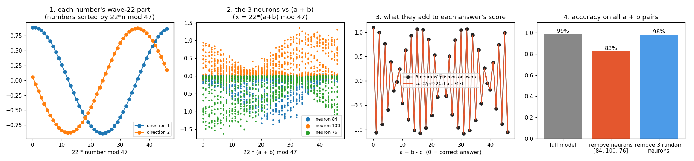
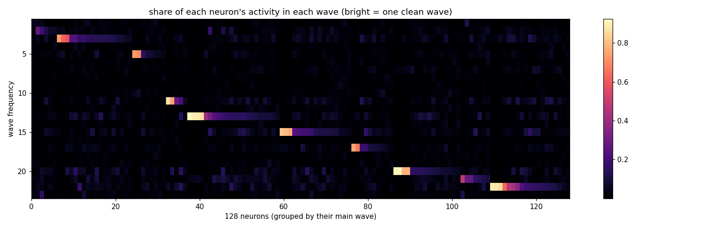
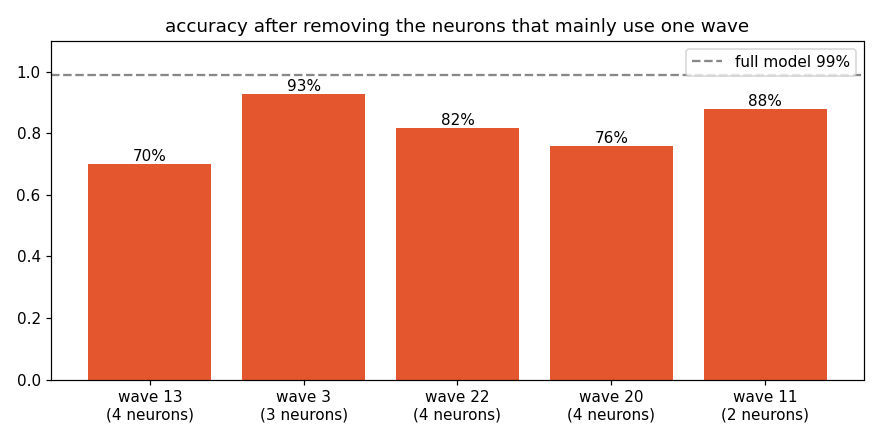

# Small neuron teams, one wave each

**Claim:** each clock is built by its own team of 2-4 of the 128 MLP neurons. Status: proven (seed 0).

**Example:** neurons 84, 100 and 76 build the speed-22 clock. Removing them drops accuracy 99% -> 83%; removing 3 random neurons leaves 98%.

One neuron looks like noise in normal number order, and becomes one smooth hill when numbers are sorted by 22 x n mod 47:

Only 19% of what the team outputs is the useful wave; the other 81% cancels with other neurons.

Related: [numbers on a clock](clock-addition.md).
