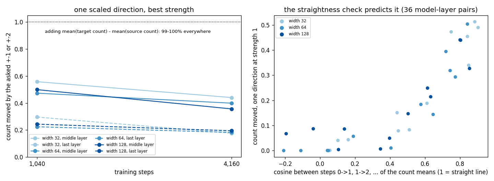

# Counts are a line in the middle of the model and separate corners in the last layer, so one scaled steering direction can't set them

**Claim:** a model that counts keeps the counts 0, 1, 2, 3, 4 close to a straight line in its middle layer, but in its last layer each count moves to its own corner. There, adding one "count direction" times a strength almost never gives the count you asked for, while adding the difference between the average state for the target count and the average state for the current count works every time. Longer training makes the bend stronger.

**Example** (width 64, 4,160 steps, 3 seeds): the model sees a sequence with two 0s and should say "2". At the last layer, adding 1× the best straight-line count direction makes it say the asked "3" in 0% of inputs (18% at the best of four strengths). Adding mean(state | count 3) − mean(state | count 2) makes it say "3" in 100%. A linear probe reads the count perfectly (100%) at both layers, so being readable by a line does not mean being steerable along one.

**The check, one number:** take the average state for each value, then the cosine between consecutive steps (mean(1) − mean(0) vs mean(2) − mean(1), and so on). 1 means a straight line. Over 36 model-layer pairs it ranks one-direction success with Spearman 0.91: cosine above 0.8 gives 44% at strength 1, below 0.3 gives 3%.

| width (16× params from 32 to 128) | steps | middle layer: step cosine | middle: one direction, best strength | last layer: step cosine | last: one direction, best strength | target − source means |
|---|---|---|---|---|---|---|
| 32 | 1,040 | 0.88 | 56% | 0.47 | 30% | 99% |
| 32 | 4,160 | 0.73 | 44% | 0.11 | 18% | 100% |
| 64 | 1,040 | 0.78 | 47% | 0.21 | 22% | 100% |
| 64 | 4,160 | 0.65 | 40% | −0.09 | 18% | 100% |
| 128 | 1,040 | 0.82 | 50% | 0.29 | 24% | 100% |
| 128 | 4,160 | 0.58 | 36% | −0.04 | 19% | 100% |

Steering moves a correctly answered count by −2, −1, +1 or +2 (counts 0-4) at the answer position; random vectors of the same size give 2-13%. At 260 steps (the 1× length) the model has not learned to count yet (28-58% right), so the trend is read from 4× and 16×. It holds at all three widths and grows with length.

**Why:** the last layer feeds the output head, and the head's rows for the answer words 0-4 are not ordered: their step cosine is −0.42 to −0.45 (a set of equally spaced separate corners gives −0.5). The last-layer count means point toward their own answer's row (cosine 0.68), and as training sharpens the answers they move from the line toward those corners. Nothing here needs a toy: any value a model writes out as its own token (a number, a year, a rating) has to end up near that token's output row.

**How to use this:** before steering a multi-level attribute by scaling one vector, compute the step cosine of its level means at the layer you steer. If it is below about 0.5, scaling will rarely land on the level you want; steer earlier, or add mean(target level) − mean(current level) instead.

**What is new and what is not:** the linear representation hypothesis ([Park 2023](https://arxiv.org/abs/2311.03658)) and steering by mean differences ([Turner 2023](https://arxiv.org/abs/2308.10248), [Marks & Tegmark 2023](https://arxiv.org/abs/2310.06824)) are known, and so are curved features such as days of the week on a circle ([Engels 2024](https://arxiv.org/abs/2405.14860)). In large models, numeric attributes have monotonic directions that edit best at relative depth 0.2-0.4 ([Heinzerling & Inui 2024](https://arxiv.org/abs/2403.10381)), last-layer states collapse toward their token's class more with scale and training ([Wu & Papyan 2024](https://arxiv.org/abs/2405.17767)), and steerability of a concept appears partway through pretraining ([She 2025](https://aclanthology.org/2025.findings-emnlp.969/)). New here: the same ordered concept turns from a line into corners between the middle and last layer, the bend grows with training length at every width, and the one-number step-cosine check predicts when a scaled direction will fail. Guess for 1B+ models (not measured): in the last third of layers, scaling one vector will rarely set a number token to a chosen value, while early-middle layers keep a step cosine above 0.7.

This is a 2-layer mixture-of-experts toy (Muon, lr 0.014, equal skill mix), so "middle" is after layer 1 of 2.

Code: [experiments/concept-directions/](../experiments/concept-directions/) (`dirs.py`, data in `runs.jsonl`, table `table.py`, figure `fig.py`).
