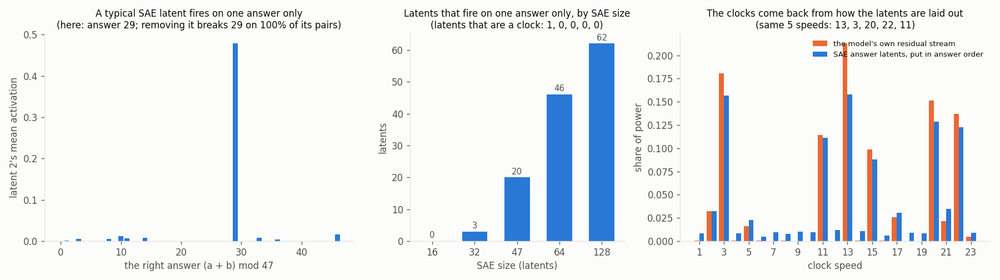

# A sparse autoencoder sees answers, not the clock

**Claim:** on a model that we know adds numbers with 5 clocks, a sparse autoencoder (SAE) finds no clock. Its latents each fire on one answer ("the answer is 29"), they pass the usual tests (one meaning, and removing one breaks exactly that answer), and they read like a lookup table. The clocks come back only when you put those latents in answer order and look at their decoder vectors. Status: proven (3 models x 3 SAE seeds).

**Example:** a 64-latent TopK SAE (4 active per input) on the residual stream of the [clock adder](clock-addition.md):
- 46 of its 64 latents each fire on a single answer. Latent 2 fires on 98% of the pairs whose answer is 29 and almost never elsewhere. Removing it from the model breaks answer 29 on 100% of its pairs, and no other answer.
- 0 of 64 latents are a clock (more than half of the latent's pattern at one clock speed). For comparison, 24 of the model's own 128 MLP neurons are.
- Put the 46 answer latents in order 0, 1, ..., 46 and Fourier-transform their decoder vectors along that order: the 5 strongest speeds are 13, 3, 20, 22, 11, the model's own 5 clocks.

| | model 0 | model 1 | model 2 |
|---|---|---|---|
| model's own clocks | 13, 3, 20, 22, 11 | 17, 3, 2, 9, 1 | 16, 5, 23, 1, 4 |
| one-answer latents (3 SAE seeds) | 46, 46, 49 | 32, 40, 37 | 23, 33, 33 |
| clock latents | 0, 0, 0 | 0, 0, 0 | 0, 0, 0 |
| removing a one-answer latent breaks its answer on | 82%, 85%, 75% of pairs | 66%, 78%, 78% | 79%, 81%, 83% |
| ... and breaks other answers on | 0.00% | 0.00% | 0.04-0.08% |
| clocks found from the decoder layout | 5/5, 5/5, 5/5 | 5/5, 5/5, 5/5 | 4/5, 5/5, 5/5 |

The SAE's size decides what the latents look like. With 16 latents each latent fires on 4-15 answers, which for 14 of the 16 latents sit near each other on one of the model's clocks (an arc of a clock); from 47 latents on, most latents are single answers; at 128 latents all 47 answers have their own latent. At no size does one latent cover a whole clock: a latent can only be positive, and a full circle needs both signs.

**Holds at 3 sizes and 3 training lengths:** model width 32, 64 and 128 (16x the hidden weights) and 300, 1200 and 4800 training steps (3 models each). At every size and length, 0-1 of 64 latents are a clock, 22-54 fire on one answer, removing one breaks its own answer on 50-87% of pairs and other answers on under 0.05%, and the decoder layout finds 3-5 of the model's 5 clocks (mostly 4-5). Table in [NOTES](../experiments/sae-clock/NOTES.md). The same tiling shows up in Claude 3.5 Haiku, where [Gurnee et al. 2026](https://arxiv.org/abs/2601.04480) find a character-count helix covered by features that each fire on a stretch of it.

**What this builds on:** [Towards Monosemanticity](https://transformer-circuits.pub/2023/monosemantic-features) and [Scaling Monosemanticity](https://transformer-circuits.pub/2024/scaling-monosemanticity/) (SAE latents with one meaning), [TopK SAEs](https://arxiv.org/abs/2406.04093) (the SAE used here), [Engels et al. 2024](https://arxiv.org/abs/2405.14860) (circular day and month features found by grouping SAE latents in GPT-2), and [On the Biology of a Large Language Model](https://transformer-circuits.pub/2025/attribution-graphs/biology.html), which reads Claude 3.5 Haiku's addition as lookup-table features like "_6 + _9 -> _5"; Anthropic's [2025 MOLT update](https://transformer-circuits.pub/2025/bulk-update/index.html) suspects that view misses geometric structure. **New here:** a test on a model whose mechanism is known. Monosemantic, causal answer latents appear while the real computation is 5 clocks, and laying the answer latents out in answer order recovers all 5 clock speeds in 44 of 45 cases.

Code: [experiments/sae-clock](../experiments/sae-clock/) (`sae.py`, `ablate.py`, `geometry.py`, `fig.py`, `scale.py`).
