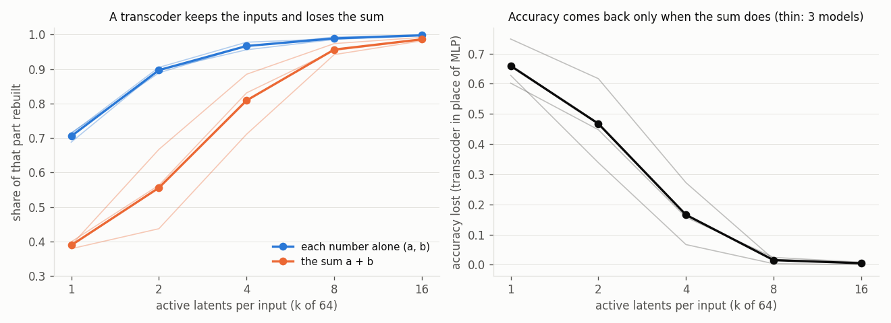
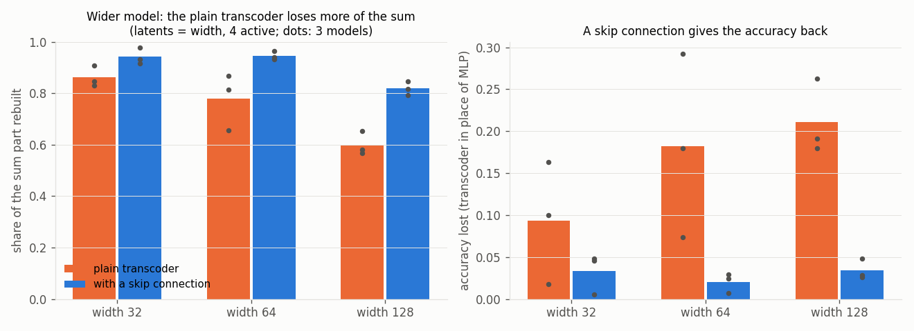

# A transcoder keeps the inputs and drops the sum

**Claim:** a transcoder (the tool behind attribution graphs: sparse latents that read an MLP's input and write its output) put in place of the adder's MLP rebuilds the parts that carry each number alone almost perfectly, and loses the part that carries their sum, which is the part the model needs. Status: proven (3 models at each of 3 widths and 3 training lengths).

**Example:** with 4 of 64 latents active per input, the transcoder explains 82% of the MLP output's variance. It rebuilds 98% of the "a alone" and "b alone" parts but only 71% of the part that depends on a + b, and the model's accuracy with the transcoder in place of its MLP falls from 99% to 72%. With 16 active latents the sum part is 98% rebuilt and accuracy is back to 98%.

| active latents (k of 64) | 1 | 2 | 4 | 8 | 16 |
|---|---|---|---|---|---|
| "each number alone" rebuilt (3 models) | 0.69-0.71 | 0.89-0.91 | 0.96-0.98 | 0.99 | 1.00 |
| "the sum" rebuilt | 0.38-0.40 | 0.44-0.67 | 0.71-0.89 | 0.94-0.97 | 0.98-0.99 |
| accuracy lost | 0.60-0.75 | 0.34-0.62 | 0.07-0.27 | 0.00-0.02 | 0.00-0.01 |

The same holds for a plain SAE on the MLP neurons (model 0, 64 latents, 4 active): 85% of the variance explained, 99% of "each number alone" rebuilt, 65% of the sum, accuracy 66%. At every sparsity the sum part is rebuilt worse than the input parts, so the transcoder's error is not noise: it is where the addition happens.

**It gets worse in wider models, and a skip connection fixes it.** With as many transcoder latents as the model is wide and 4 active, the gap between "each number alone" and "the sum" grows from 0.09 at width 32 to 0.19 at 64 and 0.39 at 128 (3 models each), and accuracy lost grows from 9% to 18% to 21%. The sum part needs more directions in a wider model (24 directions for 90% of it at width 128, 7-11 at width 32) while the number of active latents stays the same. A [skip transcoder](https://arxiv.org/abs/2501.18823), which adds a plain linear path from MLP input to output, takes over the each-alone part and frees the latents for the sum: accuracy lost falls to 0.5-5% at all three widths. Over training length (300 / 1200 / 4800 steps at width 64) the gap holds at about 0.15 and the plain transcoder keeps losing 7-10% of accuracy after 1200 steps; with the skip it loses 3-6%.

Large models show the same trend: Anthropic's cross-layer transcoders miss 11.5% of an 18-layer model's MLP output at 88 active features but 21.7% of Claude 3.5 Haiku's at 235 ([Circuit Tracing](https://transformer-circuits.pub/2025/attribution-graphs/methods.html)). **What to do:** check the transcoder on the part of the MLP output that depends on two inputs together, not only on total variance explained, and use a skip connection.

**What this builds on:** [Transcoders](https://arxiv.org/abs/2406.11944) and [Circuit Tracing](https://transformer-circuits.pub/2025/attribution-graphs/methods.html), where whatever the replacement model misses is kept as "error nodes", and [Gao et al. 2024](https://arxiv.org/abs/2406.04093), who show SAE reconstructions cost more downstream loss than their variance suggests. **New here:** on a model with a known mechanism we can split the error by meaning: it is the computed part (a + b), not the inputs, its share grows with model width, and the skip connection (proposed for lower reconstruction loss) is what rescues the computed part.

Related: [a sparse autoencoder sees answers, not the clock](sae-sees-answers-not-clocks.md). Code: [experiments/sae-clock](../experiments/sae-clock/) (`transcoder.py`, `fig.py`, `scale.py`, `fig_scale.py`).
