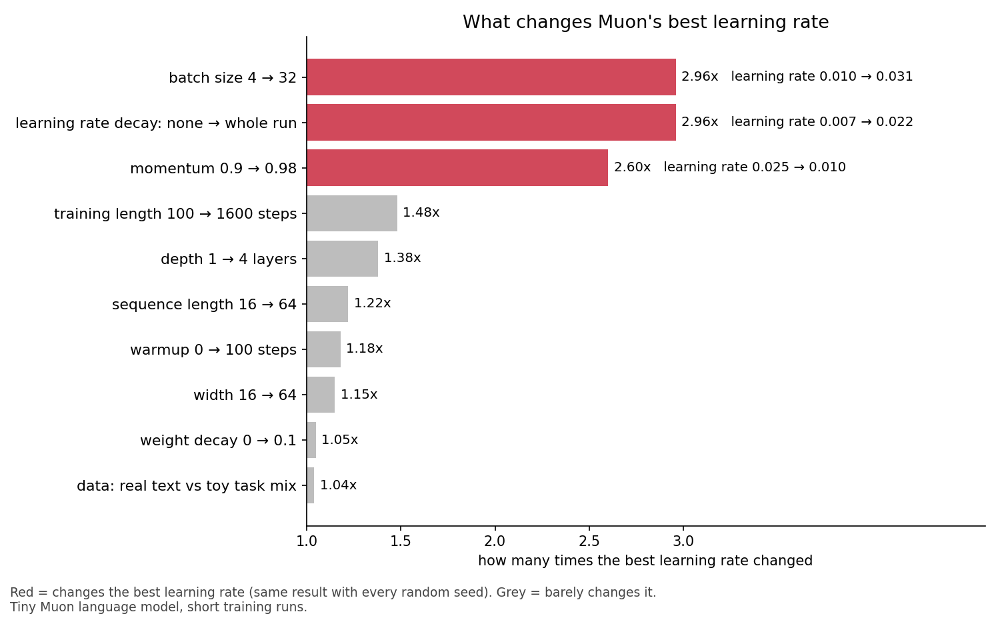
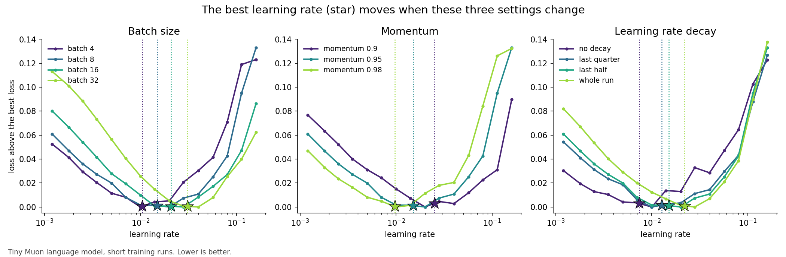

# What changes Muon's best learning rate

I found that three things influence learning rate choice for the Muon optimizer.

1. Batch size. A bigger batch needs a bigger learning rate.

new learning rate = old learning rate × √(new batch ÷ old batch)

2. Momentum (how much of the past updates each step keeps). Higher momentum needs a smaller learning rate.

new learning rate = old learning rate × ((1 − new momentum) ÷ (1 − old momentum))^0.6
> Maybe 0.6 is different for bigger LLMs

3. Learning rate decay (lowering the learning rate to zero at the end of training). The longer the decay, the bigger the learning rate you can use.

What did not influence learning rate

Model width, depth, sequence length, warmup, weight decay, and data. When you change these, you can keep your learning rate.

How to use this

There is no formula that gives you the learning rate from scratch. Labs publish formulas like DeepSeek's, but each is fitted on that lab's own model and data. On my model, DeepSeek's formula gave a much lower learning rate than the best one.

So do one learning rate search on your model. Then, when you change batch size, momentum or decay, adjust the learning rate with the rules above instead of searching again.

What is new and what is not

The batch size rule matches earlier papers, and papers also show the link between decay and learning rate. I found no paper that measures the momentum effect for Muon.

All of this is measured on a tiny model with short runs, so test it before trusting it on a big model.

## Data

Best learning rate for each value, changing one setting at a time. In brackets: the 95% range over seeds.

| setting | values | best learning rate | change | moves? |
|---|---|---|---|---|
| batch size (same number of tokens) | 4 / 8 / 16 / 32 | 0.0104 [.0083,.0133] / 0.0150 [.0121,.0187] / 0.0209 [.0165,.0271] / 0.0308 [.0262,.0353] | 2.96x | yes |
| learning rate decay (share of the run) | none / last quarter / last half / whole run | 0.0074 [.0053,.0087] / 0.0127 [.0109,.0164] / 0.0150 / 0.0219 [.0177,.0271] | 2.96x | yes |
| momentum | 0.9 / 0.95 / 0.98 | 0.0252 [.0198,.0377] / 0.0150 / 0.0097 [.0074,.0126] | 2.60x | yes |
| depth | 1 / 2 / 4 layers | 0.0128 / 0.0150 / 0.0109 | 1.38x | no |
| sequence length | 16 / 32 / 64 | 0.0132 / 0.0150 / 0.0161 | 1.22x | no |
| warmup | 0 / 20 / 100 steps | 0.0175 / 0.0150 / 0.0148 | 1.18x | no |
| width | 16 / 32 / 64 | 0.0150 / 0.0167 / 0.0173 | 1.15x | no |
| weight decay | 0 / 0.01 / 0.1 | 0.0150 / 0.0154 / 0.0147 | 1.05x | no |
| data | toy task mix / real text | 0.0150 / 0.0156 | 1.04x | no |

"Yes" means the 95% ranges at the two end values do not overlap. Single toy tasks move the best learning rate more (one task 0.0087, copying 0.0234), but copying's best learning rate depends on whether a seed finds the copy trick. The momentum power 0.6 is fitted on three momentum values; the batch power fitted here is 0.52.

Setup: 2-layer model, width 16, batch 8, sequence length 32, RoPE, QK-norm, SwiGLU, RMSNorm, Muon with momentum 0.95 (Nesterov), no weight decay, 20 warmup steps, learning rate decayed to zero over the last half, 800 steps on a mix of 20 toy tasks. 15 learning rates from 0.0012 to 0.16, 5 seeds for the rows that move (3-5 for the rest). Best learning rate = lowest point of a parabola fitted to the seed-mean loss around the minimum. Each run takes about 2.5 s on a laptop CPU. Code: [experiments/what-changes-muon-lr](../experiments/what-changes-muon-lr/) (`B=8 D=16 STEPS=800 MOM=0.98 python3 factors.py 0` for one run, `python3 factors.py fit` for the table).
